# Класифікація рентгенівських знімків грудної клітки: норма чи пневмонія

Бінарна класифікація дитячих рентгенограм (NORMAL / PNEUMONIA). Порівняно три підходи: класичне машинне навчання, згорткову мережу, навчену з нуля, і transfer learning. Окремо досліджено, чому якість на test гірша, ніж на val, і які прийоми це частково виправляють.

**Зміст**

1. [Датасет](#1-датасет)
2. [Процес навчання моделей](#2-процес-навчання-моделей)
3. [Результати](#3-результати)
4. [Висновки і обмеження](#4-висновки-і-обмеження)

---

## 1. Датасет

Набір дитячих рентгенограм грудної клітки (Kermany et al., 2018): знімки дітей віком 1-5 років з однієї лікарні. Усього **5 856 знімків** двох класів. Аналіз даних виконано в ноутбуці `01_data_exploration.ipynb`.

### 1.1. Склад і дисбаланс класів

| Частина (оригінальна) | NORMAL | PNEUMONIA |
|---|---|---|
| train | 1 341 | 3 875 |
| val | 8 | 8 |
| test | 234 | 390 |
| **Разом** | 1 583 | 4 273 |

У train пневмонія становить 74,3%, у test 62,5%. Оригінальний val складається лише з 16 знімків, тому для вибору моделей непридатний.

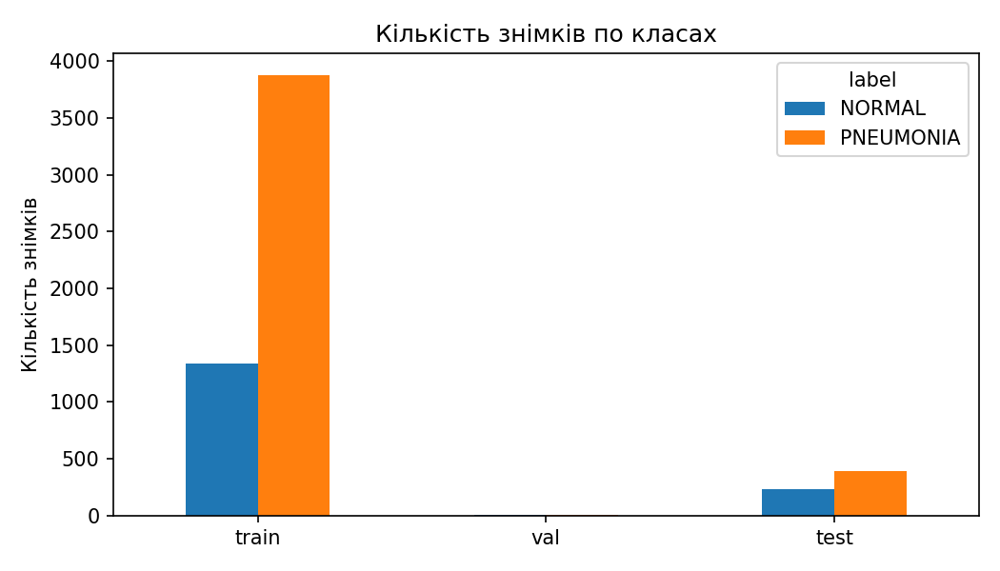

Через дисбаланс одної accuracy недостатньо, тому надалі окремо дивимось на **recall** (частка знайдених хворих) і **specificity** (частка здорових, названих здоровими).

### 1.2. Приклади знімків

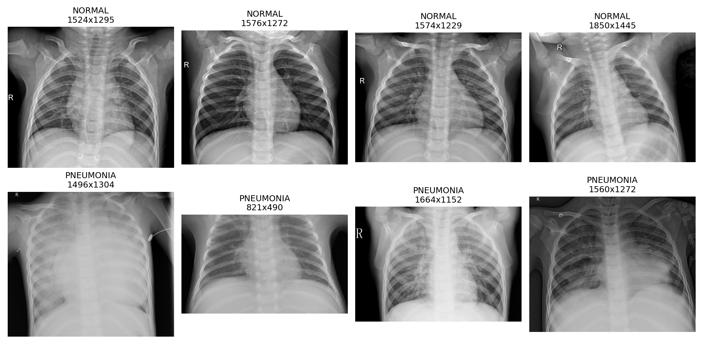

Знімки відрізняються розміром, контрастом, положенням літери R та іншими технічними деталями, тому частина знімків неоднозначна навіть для ока.

### 1.3. Розмір і формат

За випадковою вибіркою з 300 знімків:

| | Ширина | Висота |
|---|---|---|
| середнє | 1300 | 950 |
| медіана | 1284 | 888 |
| мінімум | 467 | 191 |
| максимум | 2302 | 2067 |

282 знімки чорно-білі (`L`), 18 кольорових (`RGB`). Тому всі знімки переводимо в чорно-білі й зменшуємо до квадрата: **128 × 128** (класичний ML і CNN з нуля) або **224 × 224** (transfer learning). Пропорції при цьому трохи спотворюються.

### 1.4. Пацієнти й розбиття train / val / test

З назв файлів визначено групу (пацієнта): 1 116 груп для NORMAL і 2 653 для PNEUMONIA, тобто в середньому 1,4 і 1,6 знімка на групу. Якби ділити знімки випадково, знімки одного пацієнта могли б потрапити і в train, і у val, тому оцінка стала б завищеною.

Оригінальні train і val об'єднано й поділено на 5 частин методом `StratifiedGroupKFold` (`seed = 42`): усі знімки одного пацієнта потрапляють в одну частину, пропорція класів зберігається. Одна частина стала val, решта train. Test залишено без змін (у ньому перетин пацієнтів не перевірявся).

| Частина | NORMAL | PNEUMONIA | Разом |
|---|---|---|---|
| train | 1 079 | 3 081 | 4 160 |
| val | 270 | 802 | 1 072 |
| test | 234 | 390 | 624 |

Перетин пацієнтів між train і val: 0. Розбиття збережено у [`results/splits.csv`](results/splits.csv), і всі моделі використовують саме його.

---

## 2. Процес навчання моделей

### 2.1. Загальні правила

- Модель, гіперпараметри, епоху і склад ансамблю вибираються **лише за val**. Test використовується тільки для фінальної оцінки.
- Перед кожним експериментом викликається `set_seed(42)`, тому порівняння коректне.
- Метрики скрізь однакові: accuracy, precision, recall, specificity, F1 (для моделей з ймовірностями ще AUC).

### 2.2. Класичне машинне навчання (`02_classical_ml.ipynb`)

Класичні моделі приймають вектор чисел, тому з кожного знімка побудовано два набори ознак:

- **сирі пікселі:** знімок 64 × 64 (усереднення блоків 2 × 2), значення 0-1, **4 096** ознак;
- **HOG** (гістограма орієнтованих градієнтів): клітинки 16 × 16, 9 напрямків, **1 764** ознаки. Описує контури й текстури, а не окремі пікселі.

Навчено три моделі, усі з `class_weight="balanced"`:

1. SVM (ядро RBF) на сирих пікселях. Перед ним `StandardScaler`, обидва в `pipeline`, тому масштаб рахується тільки по train.
2. SVM (RBF) на HOG. Параметр `C` підбирався на val за F1 серед 0,1; 1; 10 (таблиця нижче), вибрано `C = 10`.
3. Random Forest (300 дерев) на HOG.

Підбір `C` для SVM на HOG (val):

| C | Accuracy | Precision | Recall | Specificity | F1 |
|---|---|---|---|---|---|
| 0,1 | 0,951 | 0,986 | 0,948 | 0,959 | 0,966 |
| 1 | 0,975 | 0,987 | 0,979 | 0,963 | 0,983 |
| **10** | 0,979 | 0,984 | 0,989 | 0,952 | **0,986** |

Метрики класичних моделей ([`results/metrics_classical.csv`](results/metrics_classical.csv)):

| Модель | Частина | Accuracy | Precision | Recall | Specificity | F1 |
|---|---|---|---|---|---|---|
| SVM (сирі пікселі) | val | 0,969 | 0,984 | 0,975 | 0,952 | 0,979 |
| SVM (сирі пікселі) | test | 0,795 | 0,760 | 0,982 | 0,483 | 0,857 |
| SVM (HOG) | val | 0,979 | 0,984 | 0,989 | 0,952 | 0,986 |
| SVM (HOG) | test | 0,769 | 0,731 | 0,997 | 0,389 | 0,844 |
| Random Forest (HOG) | val | 0,961 | 0,966 | 0,983 | 0,896 | 0,974 |
| Random Forest (HOG) | test | 0,742 | 0,712 | 0,987 | 0,333 | 0,827 |

На val моделі виглядають добре (accuracy 0,96-0,98), на test різко гірше (0,74-0,80). Найкраща за val F1 модель, SVM на HOG, на test пропускає лише 1 хворого, але хибно позначає пневмонією 143 здорових з 234.

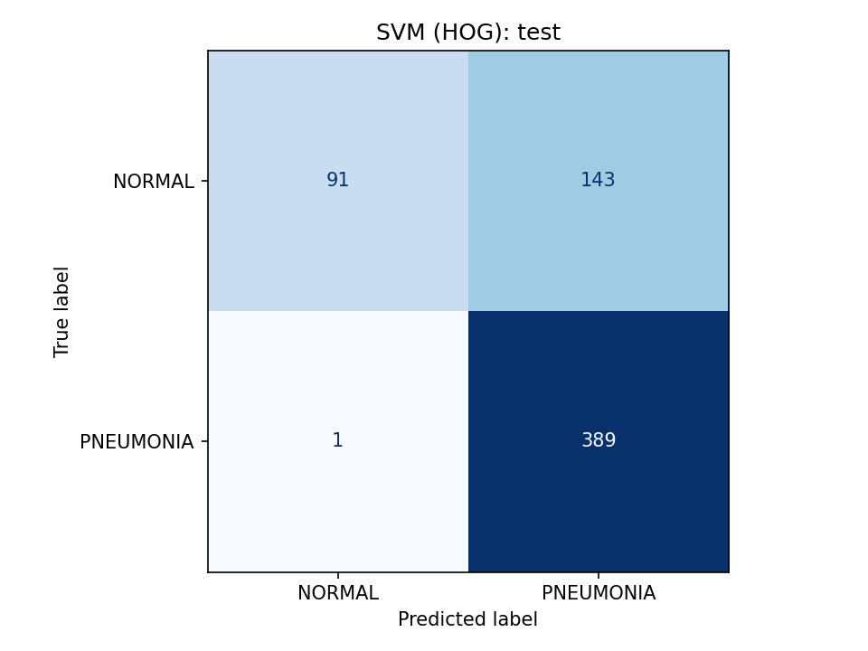

### 2.3. CNN з нуля (`03_cnn_from_scratch.ipynb`)

Власна невелика мережа з чотирьох блоків (згортка 3 × 3, `BatchNorm`, `ReLU`, `MaxPool`; канали 16 → 32 → 64 → 128), далі `AdaptiveAvgPool`, `Dropout(0,3)` і один вихідний нейрон. Усього **97 761** параметр.

Налаштування навчання:

- Adam, `lr = 1e-3`, пачки по 32 знімки, до 15 епох;
- функція втрат `BCEWithLogitsLoss`; з вагами класів `pos_weight` дорівнює відношенню кількості здорових до хворих у train (менше за 1, тож помилки на частому класі коштують менше);
- **рання зупинка** за val F1 з терпінням 5 і відновленням найкращих ваг;
- аугментація (лише для train): поворот до 10°, зсув 5%, масштаб 0,9-1,1, яскравість і контраст ±20%.

Навчено чотири варіанти: без доповнень, з аугментацією, з вагами класів, з обома. Метрики ([`results/metrics_cnn.csv`](results/metrics_cnn.csv)):

| Модель | Val F1 | Test accuracy | Test recall | Test specificity | Test F1 |
|---|---|---|---|---|---|
| CNN | 0,988 | 0,710 | 1,000 | 0,226 | 0,812 |
| CNN + аугментація | 0,975 | 0,779 | 0,985 | 0,436 | 0,848 |
| CNN + ваги класів | 0,983 | 0,744 | 0,992 | 0,329 | 0,829 |
| CNN + аугментація + ваги | 0,974 | 0,804 | 0,987 | 0,500 | 0,863 |

Аугментація і ваги класів покращують test, хоча на val цього не видно.

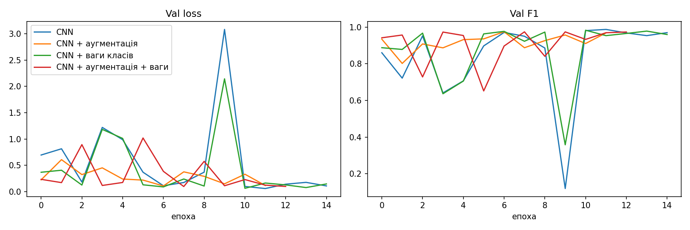

Навчання нестабільне: val loss і F1 різко стрибають між епохами (у `cnn_plain` на 10-й епосі val loss 3,08 і F1 0,12, а на 12-й F1 0,988). Тому вибір найкращої епохи за val F1 важливий. Найкращою за val F1 стала проста `CNN`, яка на test найгірша за accuracy.

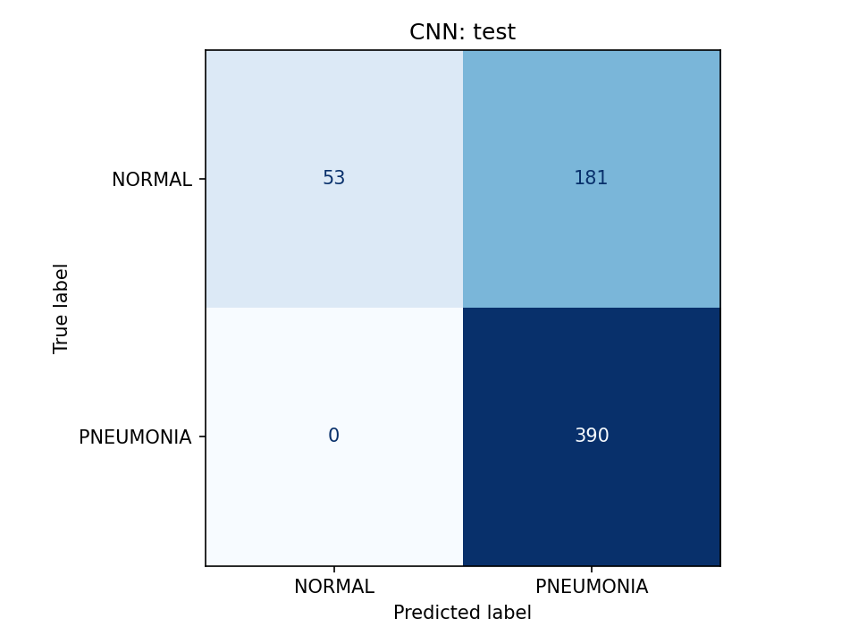

### 2.4. Transfer learning (`04_transfer_learning.ipynb`)

Узято мережі, попередньо навчені на ImageNet. Знімок 224 × 224 копіюється в 3 канали й нормується за статистикою ImageNet, останній шар замінено на `Dropout(0,3)` + один нейрон.

| Модель | Що навчається | Час епохи (CPU) |
|---|---|---|
| ResNet18, заморожена | лише новий шар (513 з понад 11 млн параметрів) | ≈ 60 с |
| ResNet18, fine-tuning | новий шар + `layer4` | ≈ 85 с |
| DenseNet121, fine-tuning | новий шар + `denseblock4` + `norm5` | ≈ 180 с |

Особливості: різний `lr` (1e-3 для нового шару, 1e-4 для розморожених блоків), аугментація і ваги класів, до 8 епох, рання зупинка (терпіння 3). `BatchNorm` у заморожених частинах переведено в режим оцінювання.

Метрики ([`results/metrics_transfer.csv`](results/metrics_transfer.csv)):

| Модель | Val F1 | Test accuracy | Test recall | Test specificity | Test F1 | Test AUC |
|---|---|---|---|---|---|---|
| ResNet18, заморожена | 0,950 | 0,872 | 0,954 | 0,735 | 0,903 | 0,951 |
| ResNet18, fine-tuning | 0,989 | 0,897 | 0,997 | 0,731 | 0,924 | 0,971 |
| DenseNet121, fine-tuning | 0,984 | 0,862 | 0,992 | 0,645 | 0,900 | 0,966 |

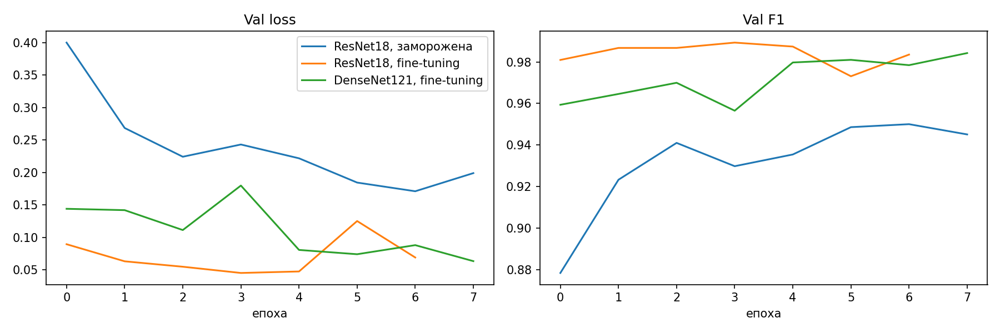

Криві значно стабільніші, ніж у CNN з нуля. ResNet18 з fine-tuning дала найкращу епоху 4 (val F1 0,989) і зупинилась на 7-й, а DenseNet121 пройшла всі 8 епох.

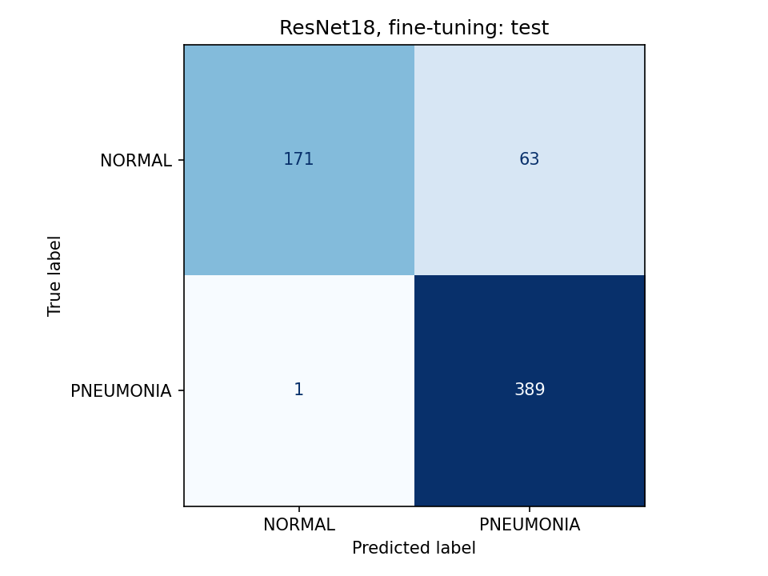

### 2.5. Діагностика розриву між val і test (`05_improvements.ipynb`)

**Гіпотеза:** знімки з різних частин датасету відрізняються технічно (яскравість, контраст), і мережа частково вчиться на цьому, а не на легенях.

Середні яскравість і контраст по оригінальних частинах (`split`) і класах:

| Частина | Клас | Яскравість | Контраст |
|---|---|---|---|
| train | NORMAL | 122,4 | 61,2 |
| train | PNEUMONIA | 123,2 | 55,1 |
| val | NORMAL | 123,8 | 64,4 |
| val | PNEUMONIA | 126,1 | 58,8 |
| test | NORMAL | 124,1 | 59,9 |
| test | PNEUMONIA | 119,2 | 55,7 |

У train і val хворі знімки яскравіші за здорові, а в test темніші. Контраст у хворих нижчий в усіх частинах.

**Контрольний експеримент.** Класифікатор (логістична регресія), який бачить лише яскравість і контраст, дає balanced accuracy:

| Частина | Balanced accuracy |
|---|---|
| train | 0,662 |
| val | 0,703 |
| test | 0,634 |

Це вище за 0,5 в усіх частинах, тобто побічні ознаки справді містять підказку про діагноз, а на test вона слабша. Це може частково пояснювати розрив, але не повністю.

**Grad-CAM** (теплові карти для ResNet18 з fine-tuning, за останнім блоком `layer4`) побудовано для трьох груп знімків test: хибні тривоги, правильно впізнані здорові й правильно впізнані хворі.

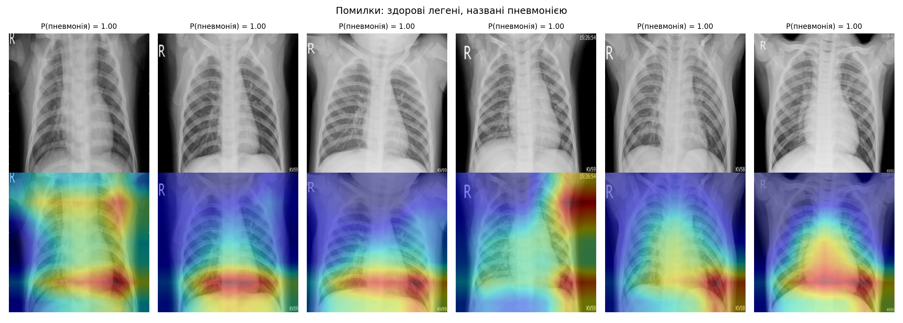

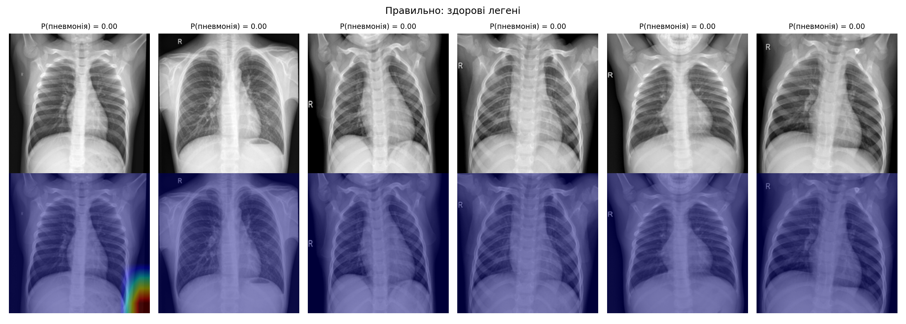

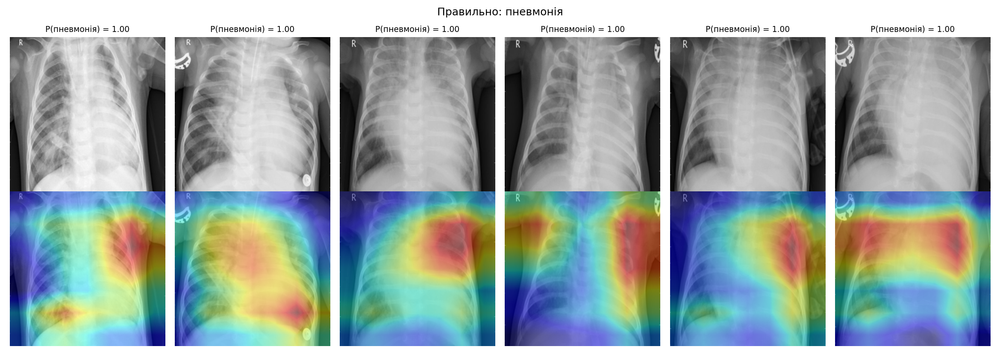

### 2.6. Нові рецепти навчання (`05_improvements.ipynb`)

Усі рецепти: ResNet18 з вагами ImageNet, **сильна аугментація** (випадкове кадрування, зсув і поворот, яскравість і контраст ±40%), ваги класів, косинусне зниження `lr`, до 10 епох, рання зупинка (терпіння 4).

| Рецепт | Розморожено | Особливість |
|---|---|---|
| `r18_strongaug` | `layer4` | лише сильніша аугментація |
| `r18_clahe` | `layer3` + `layer4` | CLAHE (локальне вирівнювання контрасту), label smoothing 0,1 |
| `r18_pernorm` | `layer3` + `layer4` | нормалізація яскравості кожного знімка, label smoothing 0,1 |

Додатково перевірено EfficientNet-B0 з CLAHE (розморожено останній блок, до 8 епох).

Результати ([`results/metrics_improved.csv`](results/metrics_improved.csv)):

| Модель | Найкраща епоха | Val F1 | Test accuracy | Test recall | Test specificity | Test F1 | Test AUC |
|---|---|---|---|---|---|---|---|
| ResNet18 ft + сильна аугментація | 7 | 0,985 | 0,918 | 0,990 | 0,799 | 0,938 | 0,981 |
| ResNet18 ft + CLAHE + layer3 | 5 | 0,982 | 0,923 | 0,992 | 0,808 | 0,942 | 0,973 |
| ResNet18 ft + норм. яскравості + layer3 | 5 | 0,988 | 0,913 | 0,990 | 0,786 | 0,935 | 0,976 |
| EfficientNet-B0 ft + CLAHE | 7 | 0,943 | 0,889 | 0,933 | 0,816 | 0,913 | 0,960 |

Усі три рецепти ResNet18 покращили test порівняно з ResNet18 з розділу 2.4 (accuracy 0,897, specificity 0,731). На val вони майже однакові (F1 0,982-0,988), тому вибрати найкращий за val неможливо. EfficientNet-B0 пропускає 26 хворих (recall 0,933) і в ансамбль не потрапила.

### 2.7. Ансамбль

Ансамбль усереднює ймовірності кількох моделей. У ансамбль «топ-3» взято три моделі з найбільшим val F1: `ResNet18, fine-tuning` (0,989), `ResNet18 ft + норм. яскравості + layer3` (0,988) і `ResNet18 ft + сильна аугментація` (0,985). Для порівняння побудовано ансамбль із трьох моделей розділу 2.4.

| Ансамбль | Val F1 | Test accuracy | Test recall | Test specificity | Test F1 | Test AUC |
|---|---|---|---|---|---|---|
| Топ-3 за val F1 | 0,988 | 0,917 | 0,997 | 0,782 | 0,937 | 0,977 |
| 3 моделі з ноутбука 04 | 0,986 | 0,899 | 0,997 | 0,735 | 0,925 | 0,971 |

---

## 3. Результати

Усі метрики зведено у [`results/final_metrics_all.csv`](results/final_metrics_all.csv), таблицю test збережено у [`results/final_table_test.csv`](results/final_table_test.csv) (ноутбук `06_comparison.ipynb`).

### 3.1. Усі моделі на test

| # | Модель | Підхід | Accuracy | Recall | Specificity | F1 | AUC | Хибні тривоги | Пропущені хворі |
|---|---|---|---|---|---|---|---|---|---|
| 1 | ResNet18 ft + CLAHE + layer3 | Transfer | 0,923 | 0,992 | 0,808 | 0,942 | 0,973 | 45 | 3 |
| 2 | ResNet18 ft + сильна аугментація | Transfer | 0,918 | 0,990 | 0,799 | 0,938 | 0,981 | 47 | 4 |
| 3 | Ансамбль (топ-3 за val F1) | Ансамбль | 0,917 | 0,997 | 0,782 | 0,937 | 0,977 | 51 | 1 |
| 4 | ResNet18 ft + норм. яскравості + layer3 | Transfer | 0,913 | 0,990 | 0,786 | 0,935 | 0,976 | 50 | 4 |
| 5 | Ансамбль (3 моделі з ноутбука 04) | Ансамбль | 0,899 | 0,997 | 0,735 | 0,925 | 0,971 | 62 | 1 |
| 6 | ResNet18, fine-tuning | Transfer | 0,897 | 0,997 | 0,731 | 0,924 | 0,971 | 63 | 1 |
| 7 | EfficientNet-B0 ft + CLAHE | Transfer | 0,889 | 0,933 | 0,816 | 0,913 | 0,960 | 43 | 26 |
| 8 | ResNet18, заморожена | Transfer | 0,872 | 0,954 | 0,735 | 0,903 | 0,951 | 62 | 18 |
| 9 | DenseNet121, fine-tuning | Transfer | 0,862 | 0,992 | 0,645 | 0,900 | 0,966 | 83 | 3 |
| 10 | CNN + аугментація + ваги | CNN з нуля | 0,804 | 0,987 | 0,500 | 0,863 | н/д | 117 | 5 |
| 11 | SVM (сирі пікселі) | Класичний ML | 0,795 | 0,982 | 0,483 | 0,857 | н/д | 121 | 7 |
| 12 | CNN + аугментація | CNN з нуля | 0,779 | 0,985 | 0,436 | 0,848 | н/д | 132 | 6 |
| 13 | SVM (HOG) | Класичний ML | 0,769 | 0,997 | 0,389 | 0,844 | н/д | 143 | 1 |
| 14 | CNN + ваги класів | CNN з нуля | 0,744 | 0,992 | 0,329 | 0,829 | н/д | 157 | 3 |
| 15 | Random Forest (HOG) | Класичний ML | 0,742 | 0,987 | 0,333 | 0,827 | н/д | 156 | 5 |
| 16 | CNN | CNN з нуля | 0,710 | 1,000 | 0,226 | 0,812 | н/д | 181 | 0 |

AUC (н/д) для класичного ML і CNN з нуля не рахувався. Хибні тривоги і пропуски наведено з 234 здорових і 390 хворих знімків test.

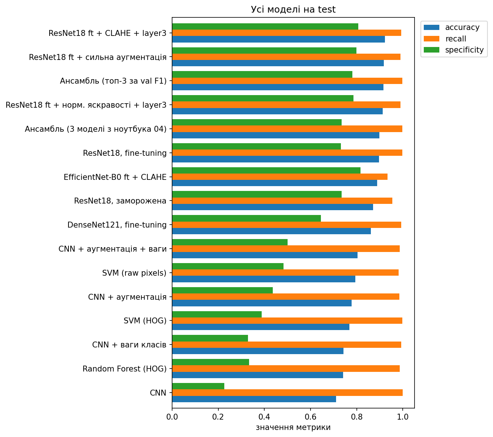

Recall майже в усіх моделей високий, а моделі відрізняються specificity, тобто кількістю хибних тривог.

### 3.2. Розрив між val і test

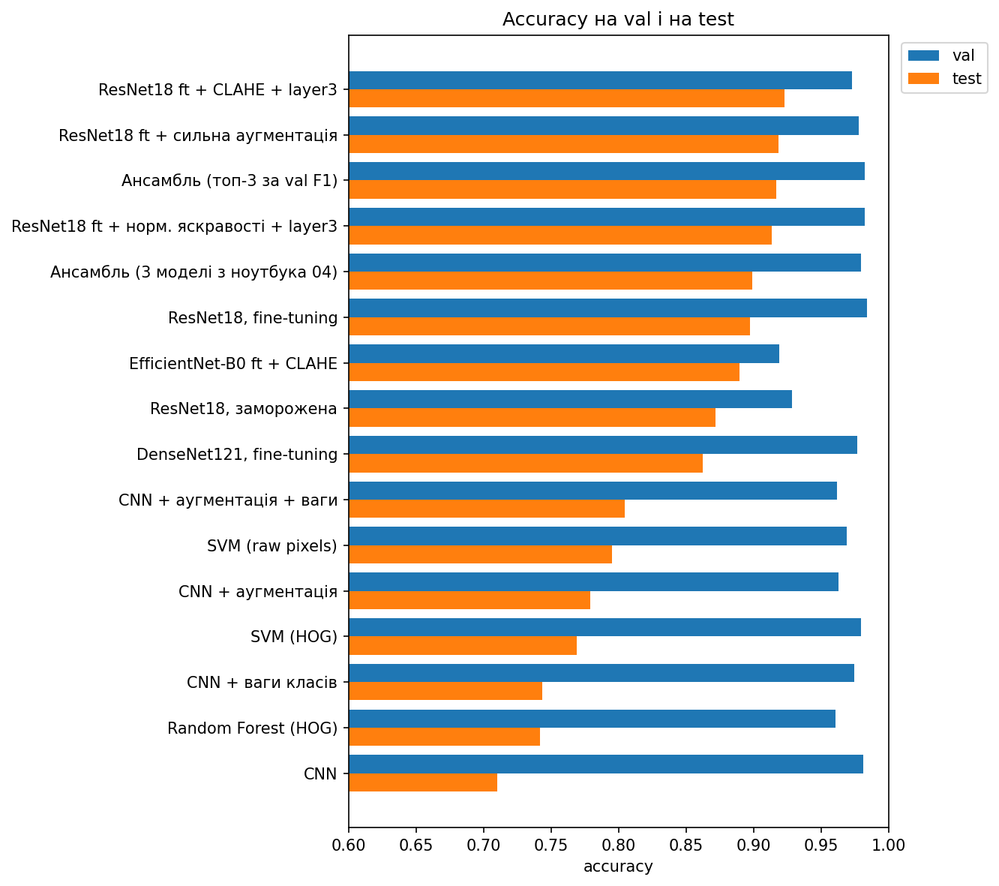

Якби val і test були однаково складними, стовпці були б майже рівні. На val усі моделі мають accuracy 0,93-0,98, а на test значно гірше, особливо класичний ML і CNN з нуля:

| Модель | Accuracy val | Accuracy test | Різниця |
|---|---|---|---|
| SVM (HOG) | 0,979 | 0,769 | 0,210 |
| CNN | 0,981 | 0,710 | 0,271 |
| ResNet18, fine-tuning | 0,984 | 0,897 | 0,087 |
| Ансамбль (топ-3) | 0,982 | 0,917 | 0,065 |

### 3.3. Найкраща модель кожного підходу (вибір за val F1)

| Підхід | Модель | Accuracy | Recall | Specificity | AUC | Хибні тривоги | Пропуски |
|---|---|---|---|---|---|---|---|
| Класичний ML | SVM (HOG) | 0,769 | 0,997 | 0,389 | н/д | 143 | 1 |
| CNN з нуля | CNN | 0,710 | 1,000 | 0,226 | н/д | 181 | 0 |
| Transfer learning | ResNet18, fine-tuning | 0,897 | 0,997 | 0,731 | 0,971 | 63 | 1 |
| Ансамбль | Топ-3 за val F1 | 0,917 | 0,997 | 0,782 | 0,977 | 51 | 1 |

Простий CNN, обраний за val F1 (0,988), на test виявився найгіршим за accuracy серед усіх 16 моделей. Тому вибір за val для цієї задачі лише орієнтовний.

### 3.4. ROC-крива і матриця помилок ансамблю

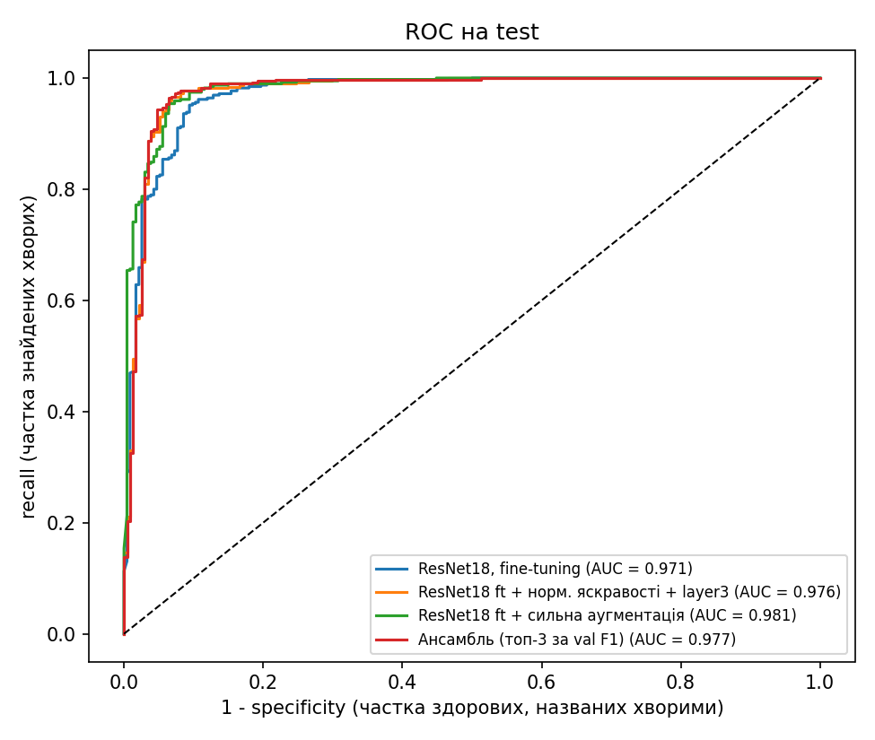

AUC усіх цих моделей високий (0,971-0,981), хоча specificity при порозі 0,5 лише 0,73-0,80. Тобто моделі непогано розрізняють класи за ймовірностями, але частина здорових знімків усе одно отримує високу ймовірність пневмонії. Поріг за test не підбирався, бо це було б підгонкою під тестові дані.

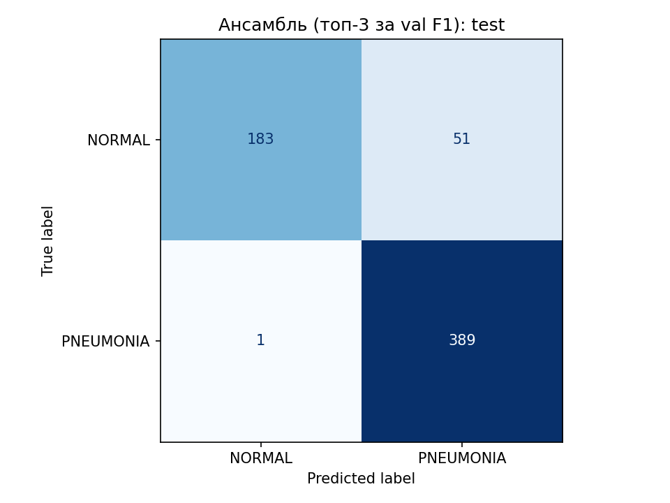

### 3.5. Стабільність найкращого рецепта (3 seed)

Рецепт `ResNet18 ft + нормалізація яскравості + layer3` повторено з трьома seed ([`results/seeds_pernorm.csv`](results/seeds_pernorm.csv)):

| Seed | Accuracy | Recall | Specificity | AUC |
|---|---|---|---|---|
| 42 | 0,913 | 0,990 | 0,786 | 0,976 |
| 1 | 0,933 | 0,995 | 0,829 | 0,955 |
| 2 | 0,929 | 0,990 | 0,829 | 0,969 |
| **Середнє** | **0,925** | **0,992** | **0,815** | **0,967** |
| **Std** | 0,010 | 0,003 | 0,025 | 0,011 |

Розкид між запусками (≈ 0,02 за accuracy) порівнянний з різницею між новими рецептами (0,913-0,923). Тому стверджувати, що один рецепт кращий за інший, не можна.

### 3.6. Порівняння зі статтею Kermany et al. (2018)

Числа статті взято з розділу Results (рентген, норма проти пневмонії) ([`results/comparison_with_paper.csv`](results/comparison_with_paper.csv)).

| | Accuracy | Recall | Specificity | AUC |
|---|---|---|---|---|
| Kermany et al., 2018 (Inception V3) | 0,928 | 0,932 | 0,901 | 0,968 |
| Наша ResNet18 ft + норм. яскравості (середнє 3 seed) | 0,925 | 0,992 | 0,815 | 0,967 |
| Наш ансамбль (топ-3 за val F1) | 0,917 | 0,997 | 0,782 | 0,977 |

Загальна якість (accuracy, AUC) така сама. Наші моделі мають вищий recall і нижчу specificity, тобто працюють в іншій точці компромісу: майже не пропускають хворих, але частіше дають хибні тривоги. Автори статті вибирали найкращу модель за test, тому їхній результат може бути трохи оптимістичним.

---

## 4. Висновки і обмеження

### Висновки

1. **Transfer learning помітно кращий** за класичний ML і CNN з нуля: accuracy на test 0,86-0,92 проти 0,71-0,80. Готові ознаки з ImageNet допомагають, хоча знімки зовсім інші, а даних небагато.
2. **Fine-tuning кращий за заморожену модель** (0,897 проти 0,872, AUC 0,971 проти 0,951). Більша DenseNet121 переваги над ResNet18 не дала (0,862).
3. **Аугментація і ваги класів** покращують test для CNN з нуля (з 0,710 до 0,804), хоча на val ефекту не видно.
4. **Розрив val / test** великий для слабких моделей (0,16-0,27) і менший для transfer learning (0,05-0,12). Одна з причин: яскравість і контраст містять підказку про діагноз, а в test вона інша. Це пояснює розрив лише частково.
5. **Нові рецепти** підняли accuracy до 0,913-0,923 і specificity до 0,79-0,81, але різниця між ними менша за розкид між seed.
6. **Ансамбль** кращий за ансамбль із моделей розділу 2.4 (0,917 проти 0,899) і майже не пропускає хворих (1 з 390), але не перевершує найкращу окрему модель.
7. **AUC високий (0,97-0,98) при specificity 0,78-0,81:** моделі розрізняють класи, а проблема швидше в порозі й зсуві даних.

### Обмеження

- Один датасет: діти 1-5 років з однієї лікарні. Результати не можна переносити на інші групи пацієнтів чи обладнання.
- У test лише 234 здорових знімки, тому одна хибна тривога змінює specificity на 0,4 відсоткового пункту. Невеликі різниці між моделями статистично ненадійні.
- Val слабко розрізняє моделі, тож вибір «найкращої» за val орієнтовний.
- У test перетин пацієнтів не перевірявся.
- Знімки стискаються до квадрата, що спотворює пропорції.
- Результати є навчальними і не призначені для клінічного використання.
